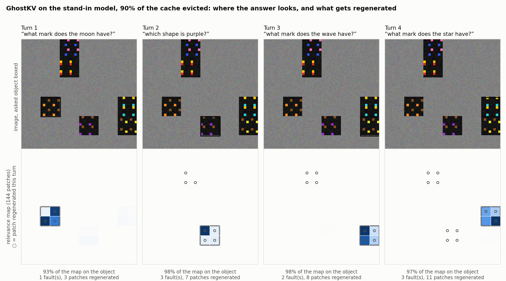

# GhostKV: regenerate only the image patches the question needs

> November 2026 update: the evaluators now put the image first and long
> contexts are made of extra images. Read `README_image_first.md` first; the
> results below were measured with the old layout (`--image-position last`).

`kv_cache_ghostkv.py` · `--method ghostkv`

SeedKV keeps a seed of the image and, for every new question, regenerates the
KV of the **whole** image, picks what it needs and drops the rest. That works,
but it is close to "save the image and re-encode it per question", and while
the question is read the cache holds the full image again (about 10x the
budget at ratio 0.9).

GhostKV does three things SeedKV does not:

1. it **estimates which image patches the current token is looking for**,
   including patches that are no longer in the cache;
2. it **regenerates only those patches, and only if they are missing**, at
   the moment the model reaches for them;
3. it turns the same signal into a **relevance map per turn**: which part of
   the image the answer was read from.

The cache never grows above its budget: there is no transient peak.

*One conversation on the stand-in model, 90% of the cache evicted. Top: the
image, the asked object boxed. Bottom: GhostKV's relevance map for that turn
(144 patches) and, as circles, the patches it regenerated. Circles away from
the box are regenerations triggered while the question was being read.*

## How it works

**Ghost keys.** In an attention layer the weight a token puts on a cached
entry depends only on the token's query and the entry's *key*. So to know
whether the model *would* look at an evicted patch you need its key, not its
value, and you need it only for heads whose attention is informative.
GhostKV keeps, for a handful of "locator" heads, the key of **every** image
patch: one vector per patch per head. On LLaVA-1.5-7B that is 147 KB per head,
the size of 9 KV entries, against 2048 entries of budget at ratio 0.9.

**Virtual attention = relevance.** At every decoding step, inside the forward
pass, each locator head's query is scored against the real cached text
entries plus the ghost keys of all 576 patches. The softmax over that is the
attention the head would pay if the whole image were cached. Summed over the
answer tokens of a turn it is the relevance map (`cache.relevance_map()`,
`--ghostkv-save-maps`, `seedkv/show_relevance.py`).

**Page fault.** If a locator head puts more than its threshold of virtual
attention on patches that are *not* in the cache, the step faults. Patches
already resident never fault.

**Partial regeneration.** The missing patches (a handful at a time) are rebuilt
from the seed with one small forward: the text before the image, then just
those patches, with the image entries still in the cache as context. This
gives their KV in every layer. A subset regenerated with all other patches as
context equals the original KV to 2e-6; with the patches actually resident at
ratio 0.9 the keys are within 5% of the originals.

**In-flight splice.** The fault is detected at the locator's layer, before
that layer's attention runs. The new KV is written into the cache of that
layer and all deeper ones while the forward pass is still running, so the
token that asked for the patches reads them in the same step (measured: its
real attention on them is 104% to 118% of what the ghost keys predicted).
Shallower layers get them after the step.

**No growth.** A paged-in patch overwrites an entry: in each head, the coldest
one by PyramidKV's score (old recent-window entries only when nothing colder
is left; never the attention sink or a token of the current turn). At most
`page_slots` paged patches are protected at a time, the ones in highest
recent demand, so a weak request cannot push out a strong recent one. This is
what stops thrashing.

**Which heads.** Found once per model by a label-free calibration run with
the full cache (about 20 conversations, no training): for each candidate
head, hide the few patches it looks at most and measure how much the
next-token distribution moves (KL). Heads whose patches matter are locators.
The same run records each head's typical attention level, which sets its
fault threshold, and how many patches it reads at a time, which sets
`page_slots`. `--ratio` and the calibration file are the only inputs.

### Example

Illustrative numbers. Image: a street with a red bus, a dog and a shop sign.
Budget: 10%.

* Turn 1, "What colour is the bus?" After the prefill PyramidKV's rule keeps
  ~60 entries per layer, mostly bus patches and text.
* Turn 2, "What does the sign say?" The sign's patches were evicted. While
  the question and the answer are processed, a locator head's query matches
  the ghost keys of the 14 sign patches: 60% of its virtual attention is on
  patches that are missing. Fault. Those 14 patches (not the other 562) go
  through the model once, their KV replaces 14 cold entries per head, and the
  same token reads them. The relevance map of turn 2 lights up on the sign.
* Turn 3, "And what is the dog doing?" Same again for the dog; the sign's
  patches, no longer in demand, are the first to be overwritten.

## What is new, and what is not

Not new, and I do not claim it:

* Regenerating KV from a compact state instead of storing it: KV-Direct
  (arXiv 2603.19664), HCache, and SeedKV here.
* Recalling evicted entries when attention is predicted to need them:
  InfiniGen (OSDI 2024) predicts important tokens with partial query/key
  weights and prefetches their KV from CPU memory; ArkVale (NeurIPS 2024)
  keeps a digest per evicted page and recalls pages from a backup store.
  Both keep the full KV somewhere. They are offloading methods.
* A few heads of a LVLM localise objects: "Your Large Vision-Language Model
  Only Needs A Few Attention Heads For Visual Grounding" (arXiv 2503.06287).
* Per-query subsets of visual tokens: SparseVILA (arXiv 2510.17777), VLCache
  (arXiv 2512.12977), Visual Cache Reuse (arXiv 2610.25136). They keep the
  visual cache and select from it.

What I did not find in any of them, and what GhostKV adds:

* The evicted KV is **not stored anywhere**. The miss is detected from keys
  of a few heads (about 2% of the budget) and the entries are **recomputed**
  for just the missing patches, from a seed that is 3.5% of the budget.
* The recomputed entries are spliced into the **running** forward pass.
* Locator heads are chosen by a **causal** test (hide what the head looks at,
  measure the output change), not by attention statistics, and the same
  heads double as a relevance estimator that sees evicted patches.
* A fixed-size cache with demand-ranked replacement, so there is no peak.

The closest single paper is InfiniGen. If a reviewer says "this is InfiniGen
with regeneration instead of a CPU copy, restricted to image tokens and a few
calibrated heads", that is a fair one-line summary of the lineage. The
difference matters in practice (nothing is stored, memory really is the
budget) but it is an extension of known ideas, not a new principle.

## Budget and cost

| | PyramidKVCache | SeedKV | GhostKV |
|---|---|---|---|
| Peak memory / nominal budget (stand-in, ratio 0.9, measured, overheads included) | 1.17 | **10.3** | **1.00** |
| Fixed overhead, LLaVA-1.5-7B at 0.9 | none | seed: 72 of 2048 entries | seed 72 + ghost keys 36 (4 heads) |
| Extra model work per later turn | none | whole prefill (~640 tokens on LLaVA) | 2 to 3 small forwards (see below) |

Stand-in, ratio 0.9, per turn: 2.0 to 2.5 faults, 84 to 102 tokens through
the model, of which about 13 are image patches and the rest is the text
before the image, recomputed at every fault so the patches see it exactly.
SeedKV pushes 186 tokens per later turn. With `--ghostkv-context resident`
the text is read from the cache instead: 6 tokens per turn, perplexity 1.040
instead of 1.037. With `--ghostkv-fault-on answer`: 1.4 faults per turn, same
perplexity. On a GPU each fault costs about one decoding step; I could not
measure that here.

### Speed

The per-token test is one batched matrix product per locator layer with a
single GPU-to-CPU sync, and a fault is handled for all heads of a layer at
once. For the lowest latency use `--ghostkv-context resident` (a fault then
recomputes only the missing patches, not the text before the image) and
`--ghostkv-fault-on answer`. Timings were not measured here (CPU only).

## Results

**Everything below ran on CPU on a stand-in**, not on LLaVA: an 8-layer,
4-head LLaVA-architecture model with 144 image patches (`make_standin.py`),
driven by the unchanged `eval_ppl_final.py` and `eval_rouge_final2.py`. It
answers 99% of questions with a full cache. Read the caveats after the tables
before trusting the ranking.

### Correctness (`python seedkv/test_ghostkv.py --standin DIR --locators FILE`)

All 27 checks pass, at ratios 0.9 and 0.5:

* All patches regenerated after the text prefix equal the original image KV
  bit for bit; a subset regenerated with the other patches as context equals
  the original to 2e-6.
* KV + seed + ghost keys is within `L * (C + appended)` at **every** cache
  call (382 calls per ratio), and no step grows a layer by more than the one
  new token.
* Bookkeeping matches the KV, no head holds a position twice, the sink stays,
  and every entry that was never paged holds exactly the original key of its
  position (1.0 M entries compared at ratio 0.5).
* The faulting token reads the paged-in patches in the same forward pass.
* Ratio 0 equals the full cache; calibration does not change the model's
  output; no fault when the threshold cannot be reached; two runs give the
  same perplexity; the evaluator runs exactly as many forwards as PyramidKV.

### Quality, ratio 0.9, 100 conversations x 4 turns

**shift**: every later turn asks about an object no earlier turn touched.
**same**: every later turn asks about the Turn-1 object again. **mixed**: the
training mix; a quarter of the first turns are "describe the image".

Perplexity of the reference answers (lower is better):

| Method | shift: all | turn 1 | later | same: all | turn 1 | later | mixed: all | turn 1 | later |
|---|---|---|---|---|---|---|---|---|---|
| Full cache | 1.00 | 1.00 | 1.00 | 1.01 | 1.01 | 1.01 | 1.04 | 1.11 | 1.00 |
| PyramidKV | 1.78 | 1.62 | 1.84 | 1.50 | 1.65 | 1.46 | 1.98 | 2.49 | 1.73 |
| TurnCast-KV (scorer trained on the stand-in) | 1.22 | 1.09 | 1.27 | 1.04 | 1.03 | 1.04 | 1.27 | 1.32 | 1.24 |
| Turn-conditioned coverage | 1.38 | 1.59 | 1.32 | 1.30 | 1.56 | 1.24 | 1.54 | 1.80 | 1.41 |
| SeedKV (regenerates the whole image) | 1.36 | 1.82 | 1.23 | 1.39 | 1.98 | 1.25 | 2.11 | 4.69 | 1.31 |
| **GhostKV** | 1.04 | 1.12 | 1.01 | 1.09 | 1.23 | 1.06 | 1.51 | 2.93 | 1.02 |
| **GhostKV**, layer sizes of PyramidKVCache | 1.03 | 1.09 | 1.01 | 1.06 | 1.14 | 1.04 | 1.43 | 2.50 | 1.02 |
| GhostKV with paging off (ablation) | 1.84 | 1.70 | 1.89 | 1.57 | 1.79 | 1.51 | 2.33 | 3.73 | 1.76 |

Generated answers equal to the reference (%):

| Method | shift: all | turn 1 | later | same: all | turn 1 | later | mixed: all | turn 1 | later |
|---|---|---|---|---|---|---|---|---|---|
| Full cache | 100 | 100 | 99 | 98 | 99 | 97 | 94 | 76 | 99 |
| PyramidKV | 38 | 45 | 35 | 54 | 54 | 53 | 38 | 35 | 40 |
| TurnCast-KV (scorer trained on the stand-in) | 76 | 84 | 74 | 94 | 97 | 92 | 69 | 59 | 72 |
| Turn-conditioned coverage | 71 | 66 | 73 | 69 | 67 | 70 | 63 | 42 | 70 |
| SeedKV (regenerates the whole image) | 58 | 30 | 67 | 57 | 33 | 65 | 51 | 22 | 61 |
| **GhostKV** | 84 | 63 | 91 | 77 | 50 | 86 | 82 | 48 | 93 |
| **GhostKV**, layer sizes of PyramidKVCache | 90 | 79 | 94 | 82 | 68 | 87 | 86 | 60 | 95 |
| GhostKV with paging off (ablation) | 35 | 36 | 34 | 49 | 43 | 51 | 36 | 28 | 39 |

"Layer sizes of PyramidKVCache" (`--seedkv-allocation pyramidkv`) gives every
layer as many entries as this repo's PyramidKVCache actually holds, which is
more than `L * C` (17% more at its peak on the stand-in). It is the like-for-like
comparison with the PyramidKV row. The plain GhostKV row uses exactly `L * C`.

By ratio, all turns, shift / same / mixed:

| | 0.8 | 0.9 | 0.95 |
|---|---|---|---|
| Perplexity: PyramidKV | 1.47 / 1.22 / 1.52 | 1.78 / 1.50 / 1.98 | 2.77 / 2.33 / 4.87 |
| Perplexity: TurnCast-KV | 1.06 / 1.01 / 1.09 | 1.22 / 1.04 / 1.27 | 2.47 / 2.14 / 2.31 |
| Perplexity: SeedKV | 1.15 / 1.19 / 1.45 | 1.36 / 1.39 / 2.11 | 2.07 / 1.81 / 4.41 |
| Perplexity: **GhostKV** | 1.03 / 1.03 / 1.28 | 1.04 / 1.09 / 1.51 | 1.61 / 1.45 / 2.45 |
| Perplexity: GhostKV, paging off | 1.50 / 1.26 / 1.66 | 1.84 / 1.57 / 2.33 | 2.65 / 2.30 / 5.20 |
| Exact answers %: PyramidKV | 58 / 75 / 59 | 38 / 54 / 38 | 15 / 20 / 14 |
| Exact answers %: SeedKV | 81 / 76 / 75 | 58 / 57 / 51 | 29 / 33 / 28 |
| Exact answers %: **GhostKV** | 95 / 94 / 87 | 84 / 77 / 82 | 66 / 60 / 66 |

### Does the relevance map point at the right place?

The stand-in's data says which object each question is about (a 2x2 block of
the 12x12 patch grid). Share of the map's top 4 patches that fall inside that
object, shift, ratio 0.9, 400 turns; chance is 0.03:

| Estimator | turn 1 | later turns |
|---|---|---|
| Real attention of all heads over what is left in the cache | 0.04 | 0.17 |
| The locator head's real attention, without ghost keys | 0.16 | 0.12 |
| **GhostKV map, summed over the answer tokens** (default) | 0.78 | 0.79 |
| **GhostKV map, the single sharpest answer token** (`peak`) | 0.99 | 0.99 |

Without ghost keys a head can only attend to what survived eviction, so its
attention cannot say that the answer is somewhere else. That is the gap the
first two rows show.

### Ablations (shift, ratio 0.9, perplexity all / turn 1 / later)

| Variant | Perplexity |
|---|---|
| GhostKV | 1.04 / 1.12 / 1.01 |
| Paging off | 1.84 / 1.70 / 1.89 |
| **No calibration file** (heads guessed from prefill attention) | 1.76 / 1.93 / 1.70 |
| Seed and ghost keys not charged | 1.03 / 1.07 / 1.02 |
| Faults only while answering | 1.04 / 1.12 / 1.01 |
| Context: resident entries only (no text recomputed) | 1.04 / 1.12 / 1.01 |
| Context: none (patches regenerated alone) | 1.04 / 1.13 / 1.02 |
| 2 locator heads instead of 1 | 1.07 / 1.26 / 1.01 |
| Threshold 0.15 / 0.7 instead of auto (0.5) | 1.04 / 1.06 overall |

### What these numbers do and do not show

* **The mechanism works.** Same code, same budget: paging takes later-turn
  perplexity from 1.89 to 1.01 on shift and exact answers from 34% to 91%.
* **The stand-in is the best case for this method, and I built it.** To make
  the small model read its image at all I trained it with an attention guide
  that makes one head (layer 3, head 0) look at the asked object. So a clean
  locator head exists by construction, and calibration finds exactly that
  head. Real LVLMs are reported to have such heads (arXiv 2503.06287), but
  whether LLaVA-1.5's are sharp enough for the fault test is **untested**.
  If they are not, GhostKV falls back to roughly "paging off".
* **Not a clean held-out estimate.** I made design choices (replacement rule,
  thresholds, pool size) while looking at the first 40 conversations of the
  test sets and at a held-out part of the calibration pool.
* **Calibration is not optional.** Without the file the gain almost vanishes
  (1.76 vs 1.84).
* **Turn 1 is not GhostKV's strength.** It is PyramidKV's rule on a budget
  reduced by the seed and ghost keys (19% of the stand-in's budget, about 5%
  on LLaVA). TurnCast-KV is better in turn 1 on every set and better overall
  on **same** (94% vs 77% exact). On **mixed** GhostKV's overall perplexity
  (1.51) is worse than TurnCast-KV's (1.27) although more of its answers are
  exactly right (82% vs 69%): the gap is the "describe the image" first
  turns, where every compressed method scores 0% and GhostKV's 4-patch pool
  cannot help. Whole-image questions are the method's blind spot.
* **The stand-in overrates all selective methods**, as noted for SeedKV: on
  LLaVA, TurnCast-KV and PyramidKV tied although they are far apart here.

## Options

| Flag | Default | Meaning |
|---|---|---|
| `--ghostkv-locators FILE` | none | Calibration file. Without it heads are guessed (weak). |
| `--ghostkv-calibrate FILE` | off | Calibration run: full cache, writes FILE. Use ~20 conversations. |
| `--ghostkv-n-locators` | 4 | At most this many heads ... |
| `--ghostkv-ghost-share` | 0.02 | ... as long as their keys fit in this share of the budget (at least 1). |
| `--ghostkv-threshold` | `auto` | Missing attention that triggers a fault. `auto`: half the head's 90th-percentile level from calibration. Lower = more faults. |
| `--ghostkv-page-slots` / `--ghostkv-page-frac` | auto / 0.3 | Protected paged patches: 30% of the layer budget, at least one "look" of the best head. |
| `--ghostkv-fault-on` | `answer` | `all`: also fault while a later-turn question is read. |
| `--ghostkv-victims` | `image` | A paged-in patch overwrites image entries only. `any`: text and old recent-window entries too when a head has no image entry left. |
| `--ghostkv-context` | `prefix+resident` | What a regenerated patch sees. `resident` skips recomputing the text (cheapest). |
| `--ghostkv-max-faults` | 0 | Cap on regenerations per turn (0 = none). |
| `--ghostkv-detect-every` | 1 | Look for faults on every n-th token. Faster, but on the stand-in it costs quality (perplexity 1.04 -> 1.22 at 2). |
| `--ghostkv-demand-decay` | 0.9 | How fast an old request fades. |
| `--ghostkv-cover` | 0.9 | A fault pages the patches holding this share of the missing attention. |
| `--ghostkv-image-weight` | 1.0 | Below 1 keeps more text at compression. No clear gain on the stand-in. |
| `--ghostkv-save-maps FILE` | off | Write every turn's relevance maps. |
| `--ghostkv-no-paging` | off | Ablation. |
| `--seedkv-allocation`, `--seedkv-window-size`, `--seedkv-no-seed-charge` | | Shared with SeedKV. |

## Files

| File | |
|---|---|
| `kv_cache_ghostkv.py` | The method (subclass of `SeedKVCache`, so `kv_cache_seedkv.py` is required). |
| `eval_ppl_final.py`, `eval_rouge_final2.py` | `ghostkv` branch in `build_cache`, the flags above. No loop change. |
| `eval_efficiency.py` | `ghostkv` in the method list, `--ghostkv-locators`. **Not run.** |
| `run-job-ghostkv` | Nova job: calibrate once, then PPL, ROUGE, efficiency. |
| `seedkv/test_ghostkv.py` | The correctness checks. |
| `seedkv/show_relevance.py` | Draws saved relevance maps over the image. |
| `seedkv/run_compare.py` | `ghostkv*` variants added. |
| `seedkv/ghostkv_standin_results.json` | Raw numbers of the tables. |

## Add it to the repo

From a clean checkout of commit `0e4a19d`:

    git apply ghostkv_full.patch            # SeedKV + GhostKV

If the SeedKV patch is already applied:

    git apply ghostkv_on_seedkv.patch

Nothing else changes: GhostKV uses the hooks SeedKV added (`attach_model`,
`begin_answer`) and needs no new call in the evaluator loops.

## Run it on LLaVA

    # 1. once per model: find the locator heads (full cache, ~20 conversations)
    python eval_ppl_final.py --model-path $MODEL --data-path $DATA --image-path $IMAGES \
        --eval-samples 20 --method ghostkv --ratio 0.9 \
        --ghostkv-calibrate locators_llava15_7b.pt --output-dir logs --exp-name calib

    # 2. evaluate
    python eval_ppl_final.py ... --method ghostkv --ratio 0.9 --ghostkv-locators locators_llava15_7b.pt
    python eval_rouge_final2.py ... --method ghostkv --ratio 0.9 --ghostkv-locators locators_llava15_7b.pt

    # or everything: sbatch run-job-ghostkv

Calibration costs about 33 extra decoding steps for each tested answer token
(the first 8 of every turn, then every 8th). Calibrate on conversations you
do not evaluate on.

Look at these first:

1. `torch.load("locators_llava15_7b.pt")`: `score` (the top heads should
   stand out), `top_mass_quantiles` and `footprint` of the best heads. If the
   best head's 90th-percentile mass is tiny (say below 0.05), LLaVA has no
   head sharp enough for this fault test at that layer and the method will
   do little.
2. Run with `--debug`: the turn-boundary line prints `faults` and
   `regen_tokens`. Zero faults means the threshold is never reached (lower
   `--ghostkv-threshold`); dozens per turn means it is too low.
3. `--ghostkv-no-paging` at the same ratio is the ablation that isolates
   paging.
4. `--ghostkv-save-maps maps.pt`, then `seedkv/show_relevance.py`, to see
   whether the maps land on what the question asks about.

## Reproduce the stand-in numbers (CPU)

    python seedkv/make_standin.py --out /tmp/standin              # ~25 min on 2 cores
    python eval_ppl_final.py --model-path /tmp/standin/llava-v1-standin \
        --data-path /tmp/standin/data/turncast_pool.json --image-path /tmp/standin/data/images \
        --device cpu --eval-samples 60 --method ghostkv --ratio 0.9 \
        --ghostkv-calibrate /tmp/standin/ghost_locators.pt --output-dir /tmp/calib --exp-name calib
    python seedkv/test_ghostkv.py --standin /tmp/standin --locators /tmp/standin/ghost_locators.pt
    python seedkv/run_compare.py --standin /tmp/standin --locators /tmp/standin/ghost_locators.pt \
        --metric ppl --methods full pyramidkv ghostkv ghostkv_no_paging --ratios 0.9 --out /tmp/ppl.json

(The evaluators need the CPU shims of `turncast/run_cpu.py`; `run_compare.py`
and the test apply them. Calibration used the first 60 conversations of the
pool; settings were chosen on conversations 120 to 240 of the pool; the tables
are on the three test sets.)

## Limits

* Batch size 1, one image, image before the dialogue (as in the evaluators).
* Faults happen on single-token forwards. The evaluators here feed later-turn
  questions token by token; a pipeline that feeds a question in one forward
  gets faults only while answering.
* Whole-image questions (describe, count) need more patches than the pool
  holds. A natural extension is to fall back to SeedKV's full regeneration
  when virtual attention is spread out.
* Retention between faults is PyramidKV's rule. GhostKV's paging is
  independent of it: TurnCast-KV's forecaster or the coverage selector could
  decide what to keep, with paging on top. Not tried.
